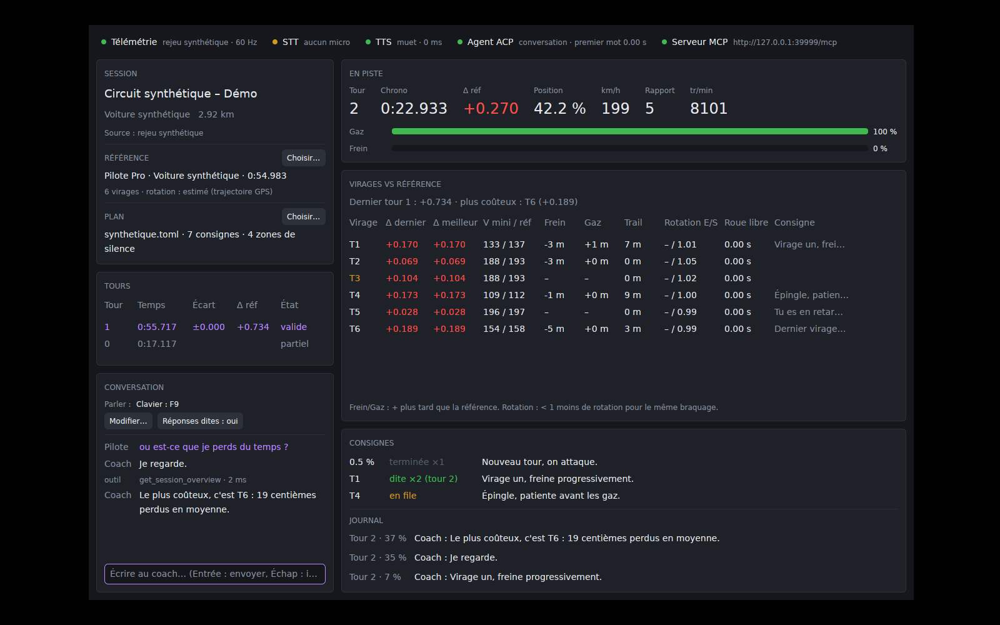

# Coach vocal de simracing pour iRacing

Application de bureau Windows en Rust qui coache le pilote à la voix pendant qu'il roule sur iRacing. Elle compare la télémétrie live à un tour de référence, planifie des consignes par virage et permet de parler au coach en roulant.

Pipeline vocal : STT → Claude (via ACP) → TTS. Le STT et le TTS tournent dans le processus avec sherpa-onnx, sans serveur ni Python. Claude accède à la télémétrie par des outils MCP exposés par le programme.

## État

| Jalon | État |
|---|---|
| 1. Télémétrie live, enregistrement des tours, affichage GPUI | **fait** |
| 2. Tour de référence, alignement, deltas par virage | **fait** |
| 3. Déclencheurs, consignes statiques, TTS | **fait** |
| 4. Serveur MCP et client ACP, saisie texte | **fait** |
| 5. STT push-to-talk, conversation vocale | **fait** |
| 6. Planification automatique du tour suivant | à faire |



Les conclusions des vérifications préalables (crates, versions, ACP, MCP, authentification, Garage61, STT/TTS, latence) sont dans [docs/verifications.md](docs/verifications.md).

## Organisation

```
crates/
  telemetry/   format irsdk, source live (Windows), rejeu .ibt, découpage en tours,
               détection des virages, rééchantillonnage, piste synthétique
  reference/   import du tour de référence : CSV Garage61, meilleur tour d'un .ibt,
               estimation de YawRate/LatAccel s'ils manquent
  analysis/    alignement sur LapDistPct, zones de virage, métriques et deltas
  triggers/    moteur de consignes (position, condition, priorité, expiration,
               silence au freinage), plan TOML, boucle rapide
  voice/       traits Tts et Stt, moteurs sherpa-onnx (Piper, Kokoro, Parakeet),
               sortie audio cpal, thread de parole, téléchargement des modèles
  mcp/         serveur MCP embarqué (rmcp, HTTP local + jeton) : outils de télémétrie
  coach/       client ACP : adaptateur Claude en sous-processus, session, latence,
               découpage de la réponse en phrases
  input/       clavier, souris, volants, boîtiers, manettes lus en arrière-plan ;
               capture de liaison, push-to-talk
  ui/          interface GPUI
  app/         binaire `simcoach` : choix de la source, lancement de l'UI
```


Boucle rapide : un thread `telemetry` lit la source à 60 Hz, découpe les tours et publie un instantané. L'UI le lit à 30 Hz sans jamais bloquer la boucle. Le thread `coach-fast` reçoit chaque échantillon via `TelemetryHub::subscribe_samples` (file bornée : un abonné lent perd des échantillons au lieu de ralentir la boucle), fait tourner le moteur de consignes et pilote le thread de parole.

## Utilisation

```sh
simcoach                              # live iRacing (Windows)
simcoach --replay session.ibt         # rejoue un .ibt comme s'il était live
simcoach --replay session.ibt --speed 4 --loop
simcoach --synthetic                  # session synthétique générée en mémoire
simcoach --write-synthetic demo.ibt   # écrit la session synthétique en .ibt
simcoach --synthetic --reference "Garage 61 - ... .csv"   # avec une référence
simcoach --write-synthetic-reference <dossier>            # référence synthétique (CSV)
```

La référence se choisit aussi dans l'interface (bouton « Choisir… »).

```sh
simcoach ... --plan plans/synthetique.toml   # plan de consignes
simcoach ... --no-voice                      # consignes affichées sans être dites
simcoach ... --model sonnet                  # modèle de la conversation (défaut : haiku)
simcoach ... --no-agent                      # sans Claude
```

En mode `--synthetic`, la référence synthétique et `plans/synthetique.toml` sont chargés par défaut. Le plan se choisit aussi dans l'interface.

## Consignes

Un plan est un fichier TOML ; la syntaxe complète est dans `crates/triggers/src/plan.rs` et un exemple commenté dans `plans/synthetique.toml`.

```toml
[[consigne]]
virage = "T4"            # virage de la carte de la piste (tirée de la référence)
ancre = "freinage"       # freinage, entree, apex ou sortie
decalage_m = -300        # 300 m avant l'ancre
texte = "Épingle, patiente avant les gaz."
priorite = 7             # 0 à 9
repetition = "chaque_tour"           # une_fois, chaque_tour ou { tours = 3 }
condition = { delta_au_dessus = 0.3 } # facultatif
```

Règles du moteur :

- une consigne est armée quand la voiture franchit sa position et que sa condition est vraie, puis dite dès qu'un créneau se libère ;
- **aucune parole en zone de freinage** : rien ne démarre pendant un freinage (pédale au-dessus de 5 %) ni dans une zone de silence (de 30 m avant le freinage de la référence jusqu'à l'apex, réglable), et une phrase en cours est coupée si le pilote freine ;
- une phrase n'est lancée que si elle a le temps d'être dite avant la prochaine zone de silence, d'après sa durée réelle (phrases synthétisées à l'avance) et la vitesse ;
- entre deux consignes en attente, la plus prioritaire passe d'abord ; au-delà de son retard maximal (150 m par défaut), une consigne est abandonnée.

## Voix

Les moteurs sont derrière les traits `voice::Tts` et `voice::Stt` : on peut changer de moteur sans toucher au reste. Implémentations actuelles : `SherpaTts::piper` (voix par défaut `fr_FR-siwis`), `SherpaTts::kokoro`, `SherpaStt::parakeet`, et `SilentTts` (muet).

Au premier lancement, la voix (environ 80 Mo) est téléchargée depuis Hugging Face dans le dossier de données de l'utilisateur (`%LOCALAPPDATA%\simcoach\data\models`), ou dans `SIMCOACH_MODELS_DIR`. Pour télécharger à l'avance, avec le modèle de reconnaissance vocale (environ 670 Mo) :

```sh
cargo run -p voice --no-default-features --example download_models -- --stt
```

La bibliothèque sherpa-onnx est téléchargée par `cargo build` depuis les releases GitHub (feature `sherpa-static`, par défaut). Sans accès à GitHub, on peut prendre la même bibliothèque sur npm (`sherpa-onnx-win-x64` ou `sherpa-onnx-linux-x64`, version 1.13.8) :

```sh
SHERPA_ONNX_LIB_DIR=<dossier de la bibliothèque> cargo build --no-default-features --features app/sherpa-shared,voice/sherpa-shared
```

Le mode rejeu et la session synthétique permettent de développer sans lancer iRacing, y compris sous Linux.

## Compilation

Rust 1.88 ou plus récent.

- **Windows** : MSVC et le Windows SDK. La compilation en release de GPUI demande `fxc.exe` (Windows SDK) ou la variable `GPUI_FXC_PATH`.
- **Linux** (développement en rejeu, CI) :

  ```sh
  sudo apt install libxkbcommon-dev libxkbcommon-x11-dev libxcb1-dev libx11-xcb-dev \
    libfreetype-dev libfontconfig-dev libwayland-dev libvulkan1 libasound2-dev \
    libudev-dev libx11-dev
  ```

```sh
cargo test --workspace
cargo run -p app --bin simcoach -- --synthetic
```

## Secrets

Les jetons sont lus dans les variables d'environnement, jamais dans le code :

- `GARAGE61_TOKEN`, optionnel, au jalon 2.

Claude est utilisé avec l'abonnement du CLI : il suffit de s'être connecté une fois avec `claude`. Il n'y a pas de clé API.

Les fichiers `.env`, `*.ibt` et `*.csv` sont ignorés par git.

## Détection des virages

La détection se fait sur le meilleur tour valide et se recalcule quand il s'améliore :

1. Courbure `YawRate / Speed`, avec repli sur `LatAccel / Speed²` si `YawRate` manque.
2. Rééchantillonnage tous les 2 m et lissage sur 30 m.
3. Seuil avec hystérésis : le virage commence sous 200 m de rayon et se termine au-dessus de 320 m.
4. Fusion des segments de même sens à moins de 40 m l'un de l'autre, et recollage d'un virage à cheval sur la ligne.

Les paramètres sont dans `CornerDetectionParams`.

À valider sur de vraies pistes : la numérotation ne suivra pas toujours la numérotation officielle. Les courbes rapides à grand rayon sont ignorées, ce qui est voulu, et une chicane compte pour deux virages. Il faudra probablement une table de correspondance par piste.

## Analyse par virage

Les virages sont détectés sur le tour de référence, qui définit la carte de la piste. Chaque virage reçoit une zone allant du milieu de la ligne droite précédente au milieu de la suivante. Les zones couvrent tout le tour sans chevauchement, donc la somme des deltas par virage égale le delta du tour.

Métriques par virage, pour chaque tour comparé à la référence :

| Métrique | Définition |
|---|---|
| Δ temps | temps passé dans la zone moins celui de la référence |
| Freinage | premier appui au-dessus de 10 % avant la vitesse minimale ; écart en mètres (+ = plus tard) |
| Trail braking | distance freinée après le début géométrique du virage |
| Vitesse minimale | et sa position (repère de l'apex) |
| Reprise des gaz | retour au-dessus de 20 % après le point le plus bas de l'accélérateur ; écart en mètres (+ = plus tard) |
| Roue libre | temps sans frein ni gaz (sous 5 %) dans la zone |
| Rotation | médiane de `YawRate / (Speed × volant)` au cœur du virage (au moins la moitié du braquage maximal, 15 m retirés aux bords), en entrée et en sortie de la vitesse minimale, rapportée à la référence. Sous 1 : moins de rotation pour le même braquage (sous-virage) ; au-dessus : plus de rotation (survirage) |

La rotation n'a de sens que pour la même voiture que la référence. Quand le `YawRate` de la référence est estimé (CSV sans ce canal), l'interface l'indique : les rapports sont alors indicatifs.

## Claude (ACP et MCP)

Le programme lance l'adaptateur `@agentclientprotocol/claude-agent-acp` (0.107.0) en sous-processus et lui parle en ACP sur stdio. Prérequis :

- s'être connecté une fois au CLI Claude (`claude`, puis `/login`) : le coach utilise l'**abonnement**. `ANTHROPIC_API_KEY` est retirée de l'environnement au démarrage pour que l'adaptateur ne l'utilise pas ;
- l'adaptateur : par défaut `claude-agent-acp` s'il est dans le PATH (exécutable autonome Windows disponible dans les releases de l'adaptateur), sinon `npx -y @agentclientprotocol/claude-agent-acp@0.107.0` (Node requis). `SIMCOACH_ACP_COMMAND` permet d'indiquer une autre commande.

La session est ouverte au démarrage et gardée chaude :

- prompt système de Claude Code remplacé par celui du coach, lu dans `%LOCALAPPDATA%\simcoach\data\sessions\conversation\CLAUDE.md` (créé au premier lancement depuis `crates/coach/prompts/CLAUDE.md`, modifiable) ;
- outils intégrés de Claude Code retirés (`tools: []`), seuls nos outils MCP autorisés ; toute autre demande de permission est refusée ;
- réglages Claude Code du poste ignorés ; réflexion coupée pour la conversation.

Chaque message du pilote est précédé d'un bloc `[Contexte]` : tour, position, dernier et prochain virage, delta live, dernières consignes dites.

Outils MCP exposés (serveur `coach`, HTTP sur `127.0.0.1`, port éphémère, jeton Bearer aléatoire) :

| Outil | Rôle |
|---|---|
| `get_session_overview()` | derniers tours, delta à la référence, temps perdu par virage, classé |
| `get_corner_summary(corner, laps)` | métriques d'un virage par tour face à la référence |
| `get_corner_trace(corner, channels, lap)` | traces (au plus 100 points par canal), tour et référence |
| `update_plan(consignes, mode)` | remplace ou complète le plan de consignes (validé avant application) |
| `say(texte, quand)` | phrase ponctuelle : maintenant, prochaine ligne droite ou position ; toujours soumise à la règle du silence au freinage |

L'interface affiche la conversation, les appels d'outils avec leur durée, et la latence du dernier tour de parole (premier mot) dans l'indicateur « Agent ACP ».

Pour développer sans Claude, un faux agent répond comme le coach (accusé, vrai appel à `get_session_overview`, réponse) :

```sh
cargo build -p coach --example mock_agent
SIMCOACH_ACP_COMMAND=target/debug/examples/mock_agent cargo run -p app --bin simcoach -- --synthetic
```

Pour mesurer la latence réelle de l'adaptateur sur le poste :

```sh
cargo run -p coach --example probe -- --model haiku --prompt "Bonjour"
```

## Conversation vocale (push-to-talk)

Le bouton de push-to-talk se règle dans l'interface, comme dans un jeu : « Modifier… », puis appuyer sur n'importe quelle touche, bouton de souris (sauf le clic gauche), bouton de volant, de boîtier, de joystick ou de manette, ou direction d'un chapeau (POV). Échap annule. Le réglage est enregistré dans `%APPDATA%\simcoach\config\settings.toml` (`SIMCOACH_SETTINGS` pour un autre fichier).

Les entrées sont lues **en arrière-plan**, pendant qu'iRacing a le focus :

- clavier et souris : état global (`GetAsyncKeyState` via `device_query`) ;
- volants, pédaliers, boîtiers, joysticks, manettes : DirectInput 8 en mode arrière-plan non exclusif, comme iRacing. Windows Gaming Input (utilisé par défaut par `gilrs`) n'a pas été retenu : il exige que la fenêtre de l'application ait le focus. Un périphérique branché en cours de route est détecté en deux secondes ; si l'identifiant d'instance change (autre port USB), le nom du produit suffit à retrouver le bouton.

Déroulé :

1. appui : le coach se tait, sa réponse en cours est interrompue, le micro enregistre (300 ms de pré-enregistrement pour ne pas couper la première syllabe) ;
2. relâchement : transcription par Parakeet (téléchargé au premier lancement, environ 670 Mo) ;
3. le texte part à Claude avec le contexte du pilote ;
4. la réponse est découpée en phrases au fil de l'eau ; chaque phrase est dite dès qu'elle est complète, via le moteur de consignes, donc jamais en zone de freinage. « Réponses dites : non » coupe la voix des réponses (le texte reste affiché).

L'interface affiche la latence du dernier tour vocal : fin de parole → texte → premier mot de Claude → premier son.
