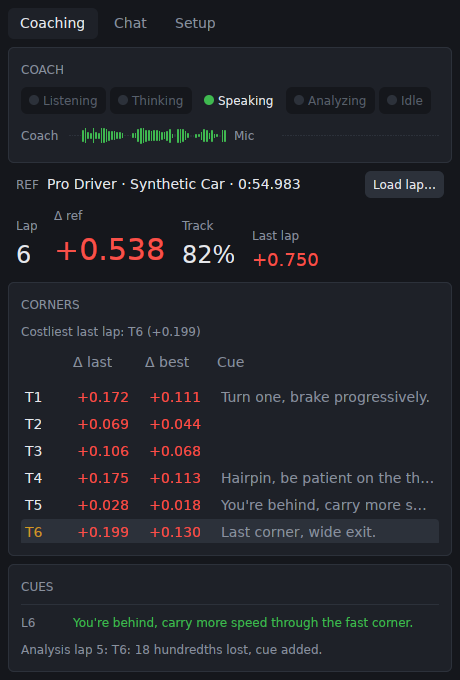
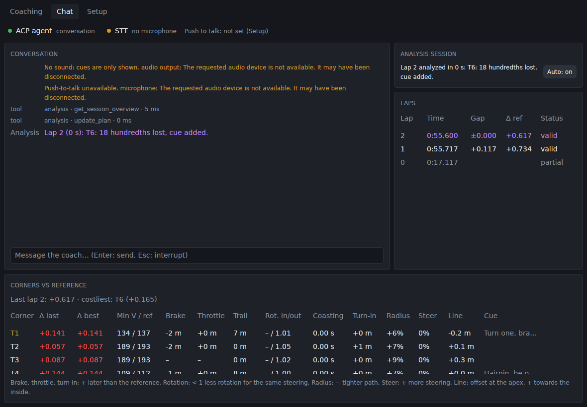

# Voice simracing coach for iRacing

Windows desktop application in Rust that coaches the driver by voice while they drive in iRacing. It compares live telemetry to a reference lap, schedules cues per corner and lets the driver talk to the coach while driving.

Voice pipeline: STT → Claude (via ACP) → TTS. STT and TTS run in-process with sherpa-onnx, with no server and no Python. Claude reads the telemetry through MCP tools exposed by the program.

## Status

| Milestone | Status |
|---|---|
| 1. Live telemetry, lap recording, GPUI display | **done** |
| 2. Reference lap, alignment, per-corner deltas | **done** |
| 3. Triggers, static cues, TTS | **done** |
| 4. MCP server and ACP client, text input | **done** |
| 5. Push-to-talk STT, voice conversation | **done** |
| 6. Automatic planning of the next lap | **done** |

## Interface

Three screens, switched with the tabs at the top:

- **Coaching**: the screen to keep next to (or on top of) the game. Coach state lights (*Listening*, *Thinking*, *Speaking*, *Analyzing*, *Idle*), rolling level meters for the coach's voice and the microphone, the reference lap with a quick **Load lap…** button, the live delta, the delta per corner (last lap, best lap, active cue) and the upcoming and last spoken cues. On Windows, **Pin on top** keeps this screen above the game in a compact 460 × 680 window (saved in the settings); **Unpin** releases it and restores the previous size. With the Setup option *Pin it on top automatically while iRacing is running* (on by default), the window pins itself as soon as the live iRacing telemetry connects and is released when iRacing closes; pinning or unpinning by hand always wins. It works over a borderless or windowed game, not over exclusive fullscreen.
- **Chat**: what a chat interface would show. The conversation (typed or spoken), the coach's tool calls, each analysis summary and the analysis session's tool calls, the laps, and the detailed corner metrics (braking, throttle, trail braking, rotation, coasting).
- **Setup**: session, reference and plan files, voice settings (push-to-talk button, spoken replies, voice language, microphone and coach output), automatic planning, always on top, and the connection status (telemetry, STT, TTS, ACP agent, MCP server).

<p>


</p>

The conclusions of the preliminary checks (crates, versions, ACP, MCP, authentication, Garage61, STT/TTS, latency) are in [docs/verifications.md](docs/verifications.md).

## Layout

```
crates/
  telemetry/   irsdk format, live source (Windows), .ibt replay, lap splitting,
               corner detection, resampling, synthetic track
  reference/   reference lap import: Garage61 CSV, best lap of an .ibt,
               YawRate/LatAccel estimation when missing
  analysis/    alignment on LapDistPct, corner zones, metrics and deltas
  triggers/    cue engine (position, condition, priority, expiry,
               silence under braking), TOML plan, fast loop
  voice/       Tts and Stt traits, sherpa-onnx engines (Piper, Kokoro, Parakeet),
               cpal audio output, speech thread, model download
  mcp/         embedded MCP server (rmcp, local HTTP + token): telemetry tools
  coach/       ACP client: Claude adapter as a subprocess, session, latency,
               splitting the reply into sentences
  input/       keyboard, mouse, wheels, button boxes, gamepads read in the background;
               binding capture, push-to-talk
  ui/          GPUI interface
  app/         `simcoach` binary: source selection, UI startup
```


Fast loop: a `telemetry` thread reads the source at 60 Hz, splits laps and publishes a snapshot. The UI reads it at 30 Hz without ever blocking the loop. The `coach-fast` thread receives every sample through `TelemetryHub::subscribe_samples` (bounded queue: a slow subscriber drops samples instead of slowing the loop down), runs the cue engine and drives the speech thread.

## Usage

```sh
simcoach                              # live iRacing (Windows)
simcoach --replay session.ibt         # replays an .ibt as if it were live
simcoach --replay session.ibt --speed 4 --loop
simcoach --synthetic                  # synthetic session generated in memory
simcoach --write-synthetic demo.ibt   # writes the synthetic session as an .ibt
simcoach --synthetic --reference "Garage 61 - ... .csv"   # with a reference
simcoach --write-synthetic-reference <folder>             # synthetic reference (CSV)
```

The reference can also be chosen in the interface (**Load lap…** on the Coaching screen).

```sh
simcoach ... --plan plans/synthetic.toml     # cue plan
simcoach ... --no-voice                      # cues shown but not spoken
simcoach ... --model sonnet                  # conversation model (default: haiku)
simcoach ... --analysis-model opus           # planning model (default: sonnet)
simcoach ... --no-planning                   # no analysis session
simcoach ... --no-agent                      # no Claude
```

In `--synthetic` mode, the synthetic reference and `plans/synthetic.toml` are loaded by default. The plan can also be chosen in the interface.

## Cues

A plan is a TOML file; the full syntax is in `crates/triggers/src/plan.rs` and a commented example in `plans/synthetic.toml`.

```toml
[settings]
quiet_lead_m = 30        # silence from 30 m before the reference braking point
quiet_until = "apex"     # brake_release, apex or exit
max_delay_m = 150        # drop a cue spoken more than 150 m late

[[trigger]]
id = "t4"
corner = "T4"            # corner of the track map (taken from the reference)
anchor = "braking"       # braking, entry, apex or exit
offset_m = -300          # 300 m before the anchor
text = "Hairpin, be patient before the throttle."
priority = 7             # 0 to 9
repeat = "every_lap"     # "once", "every_lap" or { laps = 3 }
condition = { delta_above = 0.3 }   # optional
expire_after_laps = 2    # optional

[[trigger]]
position = 0.005         # absolute position (LapDistPct), no corner
text = "New lap."
repeat = "once"
```

Available conditions: `speed_above_kmh`, `speed_below_kmh`, `delta_above`, `delta_below` (live delta to the reference, in seconds) and `min_lap`.

Engine rules:

- a cue is armed when the car crosses its position and its condition holds, then spoken as soon as a slot frees up;
- **no speech in braking zones**: nothing starts during braking (pedal above 5 %) or inside a quiet zone (from 30 m before the reference braking point to the apex, adjustable), and a sentence in progress is cut off if the driver brakes;
- a sentence is only started if it has time to be spoken before the next quiet zone, based on its actual duration (sentences are synthesized in advance) and the speed;
- among pending cues, the highest priority goes first; past its maximum delay (150 m by default), a cue is dropped.

## Voice

The engines sit behind the `voice::Tts` and `voice::Stt` traits, so an engine can be swapped without touching the rest. Current implementations: `SherpaTts::piper` (`en_US-ljspeech` or `fr_FR-siwis`, depending on the voice language), `SherpaTts::kokoro`, `SherpaStt::parakeet`, and `SilentTts` (mute).

On first launch, the voice of the selected language (about 80 MB) is downloaded from Hugging Face into the user's data folder (`%LOCALAPPDATA%\simcoach\data\models`), or into `SIMCOACH_MODELS_DIR`. To download in advance both voices (or one, with `--language en|fr`), together with the speech recognition model (about 670 MB):

```sh
cargo run -p voice --no-default-features --example download_models -- --stt
```

The sherpa-onnx library is downloaded by `cargo build` from the GitHub releases (`sherpa-static` feature, on by default). Without access to GitHub, the same library is available on npm (`sherpa-onnx-win-x64` or `sherpa-onnx-linux-x64`, version 1.13.8):

```sh
SHERPA_ONNX_LIB_DIR=<library folder> cargo build --no-default-features --features app/sherpa-shared,voice/sherpa-shared
```

Replay mode and the synthetic session make it possible to develop without running iRacing, including on Linux.

## Voice language

The voice language is English or French. It sets:

- the text-to-speech voice: Piper `en_US-ljspeech` (public-domain LJ Speech dataset) or Piper `fr_FR-siwis` (CC-BY 4.0);
- the language Claude replies in, for the conversation and for the cues it writes (`say`, `update_plan`): a "Language" section is appended to both system prompts at startup;
- speech recognition needs no setting: Parakeet v3 recognizes both languages.

Choose it with the **Voice** button on the Setup screen (applies on the next launch; saved in `settings.toml` as `language = "en"` or `"fr"`), or with `--language en|fr` on the command line, which overrides the setting. English is the default.

Everything else (interface, logs, plan files, prompts, the `[Context]` block sent to Claude) is in English. A French `CLAUDE.md` left by v0.1.0 in the conversation session folder is renamed `CLAUDE.v0.1.md` and replaced by the English default.

## Building

Rust 1.88 or newer.

- **Windows**: MSVC and the Windows SDK. A release build of GPUI needs `fxc.exe` (Windows SDK) or the `GPUI_FXC_PATH` variable.
- **Linux** (replay development, CI):

  ```sh
  sudo apt install libxkbcommon-dev libxkbcommon-x11-dev libxcb1-dev libx11-xcb-dev \
    libfreetype-dev libfontconfig-dev libwayland-dev libvulkan1 libasound2-dev \
    libudev-dev libx11-dev
  ```

```sh
cargo test --workspace
cargo run -p app --bin simcoach -- --synthetic
```

## Secrets

Tokens are read from environment variables, never from the code:

- `GARAGE61_TOKEN`, optional, from milestone 2.

Claude is used with the CLI subscription: logging in once with `claude` is enough. There is no API key.

The `.env`, `*.ibt` and `*.csv` files are ignored by git.

## Corner detection

Detection runs on the best valid lap and is recomputed when it improves:

1. Curvature `YawRate / Speed`, falling back to `LatAccel / Speed²` if `YawRate` is missing.
2. Resampling every 2 m and smoothing over 30 m.
3. Threshold with hysteresis: a corner starts below a 200 m radius and ends above 320 m.
4. Merging of same-direction segments less than 40 m apart, and rejoining of a corner that straddles the line.

The parameters are in `CornerDetectionParams`.

Still to be validated on real tracks: the numbering will not always match the official one. Fast, large-radius bends are ignored, which is intended, and a chicane counts as two corners. A per-track mapping table will probably be needed.

## Per-corner analysis

Corners are detected on the reference lap, which defines the track map. Each corner gets a zone running from the middle of the previous straight to the middle of the next one. The zones cover the whole lap without overlap, so the sum of the per-corner deltas equals the lap delta.

Per-corner metrics, for each lap compared to the reference:

| Metric | Definition |
|---|---|
| Δ time | time spent in the zone minus the reference's |
| Braking | first press above 10 % before the minimum speed; gap in meters (+ = later) |
| Trail braking | distance braked after the geometric start of the corner |
| Minimum speed | and its position (apex marker) |
| Throttle pickup | return above 20 % after the lowest throttle point; gap in meters (+ = later) |
| Coasting | time with neither brake nor throttle (below 5 %) in the zone |
| Rotation | median of `YawRate / (Speed × steering)` in the core of the corner (at least half the maximum steering angle, 15 m trimmed at each edge), before and after the minimum speed, relative to the reference. Below 1: less rotation for the same steering (understeer); above: more rotation (oversteer) |

Rotation is only meaningful with the same car as the reference. When the reference `YawRate` is estimated (CSV without that channel), the interface says so: the ratios are then only indicative.

## Claude (ACP and MCP)

The program starts the `@agentclientprotocol/claude-agent-acp` adapter (0.107.0) as a subprocess and talks ACP to it over stdio. Requirements:

- having logged in once to the Claude CLI (`claude`, then `/login`): the coach uses the **subscription**. `ANTHROPIC_API_KEY` is removed from the environment at startup so the adapter does not use it;
- the adapter: by default `claude-agent-acp` if it is on the PATH (a standalone Windows executable is available in the adapter's releases), otherwise `npx -y @agentclientprotocol/claude-agent-acp@0.107.0` (requires Node). `SIMCOACH_ACP_COMMAND` sets a different command.

The session is opened at startup and kept warm:

- Claude Code's system prompt is replaced by the coach's, read from `%LOCALAPPDATA%\simcoach\data\sessions\conversation\CLAUDE.md` (created on first launch from `crates/coach/prompts/CLAUDE.md`, editable);
- Claude Code's built-in tools are removed (`tools: []`), only our MCP tools are allowed; any other permission request is denied;
- the machine's Claude Code settings are ignored; thinking is disabled for the conversation.

Each driver message is preceded by a `[Context]` block: lap, position, last and next corner, live delta, last cues spoken.

MCP tools exposed (server `coach`, HTTP on `127.0.0.1`, ephemeral port, random Bearer token):

| Tool | Purpose |
|---|---|
| `get_session_overview()` | latest laps, delta to the reference, time lost per corner, ranked |
| `get_corner_summary(corner, laps)` | metrics of one corner per lap against the reference |
| `get_corner_trace(corner, channels, lap)` | traces (at most 100 points per channel), lap and reference |
| `update_plan(triggers, mode)` | replaces (`replace`) or extends (`add`) the cue plan (validated before being applied) |
| `say(text, when, corner, anchor, offset_m, position)` | one-off sentence: `now`, `next_straight` or at a `position` (corner + anchor + offset, or absolute position); always subject to the silence-under-braking rule |

The interface shows the conversation, the tool calls with their duration, and the latency of the last speaking turn (first word) in the ACP agent indicator.

To develop without Claude, a mock agent answers like the coach (acknowledgement, real call to `get_session_overview`, reply):

```sh
cargo build -p coach --example mock_agent
SIMCOACH_ACP_COMMAND=target/debug/examples/mock_agent cargo run -p app --bin simcoach -- --synthetic
```

To measure the adapter's actual latency on the machine:

```sh
cargo run -p coach --example probe -- --model haiku --prompt "Hello"
```

## Voice conversation (push-to-talk)

The push-to-talk button is set on the Setup screen, as in a game: click the edit button, then press any key, mouse button (except left click), wheel, button box, joystick or gamepad button, or hat (POV) direction. Escape cancels. The setting is saved in `%APPDATA%\simcoach\config\settings.toml` (`SIMCOACH_SETTINGS` for a different file).

Inputs are read **in the background**, while iRacing has focus:

- keyboard and mouse: global state (`GetAsyncKeyState` via `device_query`);
- wheels, pedals, button boxes, joysticks, gamepads: DirectInput 8 in non-exclusive background mode, like iRacing. Windows Gaming Input (used by default by `gilrs`) was not chosen: it requires the application window to have focus. A device plugged in while running is detected within two seconds; if the instance identifier changes (different USB port), the product name is enough to find the button again.

Sequence:

1. press: the coach goes quiet, its current reply is interrupted, the microphone records (300 ms of pre-roll so the first syllable is not cut);
2. release: transcription by Parakeet (downloaded on first launch, about 670 MB);
3. the text is sent to Claude with the driver's context;
4. the reply is split into sentences as it streams; each sentence is spoken as soon as it is complete, through the cue engine, so never in a braking zone. A toggle in the Setup screen mutes spoken replies (the text is still shown).

The interface shows the latency of the last voice turn: end of speech → text → Claude's first word → first sound.

### Audio devices

The Setup screen has a **Microphone** row (push-to-talk input) and a **Coach output** row (the coach's voice: cues and spoken replies). **Change…** lists the devices (WASAPI endpoints on Windows) with **System default** first; the selected device opens immediately, without a restart, and is saved in `settings.toml` by its id (`[microphone]` / `[output]` with `id` and `name`). For example, the coach can speak in the headset while the game sound goes to the speakers.

If the saved device is not connected at startup, the program falls back to the system default and says so in the conversation. If a device cannot be opened when chosen, the previous one stays active.

## Automatic planning of the next lap

A second ACP session, separate from the conversation, plays the race engineer (Sonnet by default, `--analysis-model`, thinking allowed). On each complete, valid lap:

1. the program sends it the summary: lap time, session overview (`get_session_overview`, attached to the message to save a call) and active coach cues;
2. Claude digs into the most costly corners (`get_corner_summary`, `get_corner_trace` when needed);
3. it replaces the **coach cue layer** with `update_plan`: at most three cues, placed before the braking points, expiring after two laps;
4. its one-sentence summary is shown on the Coaching screen and added to the Chat log, with the analysis session's tool calls.

The driver's plan (TOML file) is never modified: the two layers are resolved separately and spoken together, with coach cues listed alongside the driver's. A cue unchanged from one plan to the next keeps its state (a `once` cue already spoken is not repeated). A lap completed during an analysis is ignored; the analysis blocks neither the fast loop nor the conversation. Each session has its own MCP endpoint, so the tool logs stay separate.

The engineer's prompt is in `%LOCALAPPDATA%\simcoach\data\sessions\analysis\CLAUDE.md` (created from `crates/coach/prompts/ANALYSIS.md`). A toggle on the Setup screen (and on the Chat screen) enables or suspends planning (the setting is saved).

Cost: one analysis per valid lap with Sonnet, on the subscription. Over a long session, this is the main quota consumer; `--no-planning` or turning the auto toggle off stops it.
