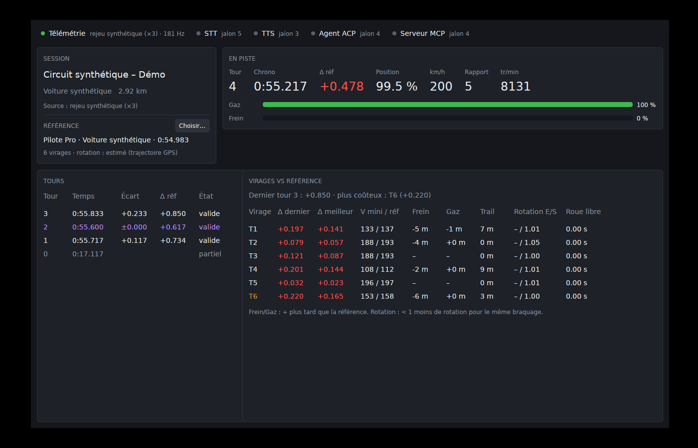

# Coach vocal de simracing pour iRacing

Application de bureau Windows en Rust qui coache le pilote à la voix pendant qu'il roule sur iRacing. Elle compare la télémétrie live à un tour de référence, planifie des consignes par virage et permet de parler au coach en roulant.

Pipeline vocal : STT → Claude (via ACP) → TTS. Le STT et le TTS tournent dans le processus avec sherpa-onnx, sans serveur ni Python. Claude accède à la télémétrie par des outils MCP exposés par le programme.

## État

| Jalon | État |
|---|---|
| 1. Télémétrie live, enregistrement des tours, affichage GPUI | **fait** |
| 2. Tour de référence, alignement, deltas par virage | **fait** |
| 3. Déclencheurs, consignes statiques, TTS | à faire |
| 4. Serveur MCP et client ACP, saisie texte | à faire |
| 5. STT push-to-talk, conversation vocale | à faire |
| 6. Planification automatique du tour suivant | à faire |



Les conclusions des vérifications préalables (crates, versions, ACP, MCP, authentification, Garage61, STT/TTS, latence) sont dans [docs/verifications.md](docs/verifications.md).

## Organisation

```
crates/
  telemetry/   format irsdk, source live (Windows), rejeu .ibt, découpage en tours,
               détection des virages, rééchantillonnage, piste synthétique
  reference/   import du tour de référence : CSV Garage61, meilleur tour d'un .ibt,
               estimation de YawRate/LatAccel s'ils manquent
  analysis/    alignement sur LapDistPct, zones de virage, métriques et deltas
  ui/          interface GPUI
  app/         binaire `simcoach` : choix de la source, lancement de l'UI
```

Les crates `coach`, `mcp`, `voice` et `triggers` seront ajoutées avec leurs jalons.

Boucle rapide : un thread `telemetry` lit la source à 60 Hz, découpe les tours et publie un instantané. L'UI le lit à 30 Hz sans jamais bloquer la boucle. Les consommateurs temps réel (déclencheurs, jalon 3) s'abonnent aux échantillons par `TelemetryHub::subscribe_samples`, via une file bornée : un abonné lent perd des échantillons au lieu de ralentir la boucle.

## Utilisation

```sh
simcoach                              # live iRacing (Windows)
simcoach --replay session.ibt         # rejoue un .ibt comme s'il était live
simcoach --replay session.ibt --speed 4 --loop
simcoach --synthetic                  # session synthétique générée en mémoire
simcoach --write-synthetic demo.ibt   # écrit la session synthétique en .ibt
simcoach --synthetic --reference "Garage 61 - ... .csv"   # avec une référence
simcoach --write-synthetic-reference <dossier>            # référence synthétique (CSV)
```

La référence se choisit aussi dans l'interface (bouton « Choisir… »).

Le mode rejeu et la session synthétique permettent de développer sans lancer iRacing, y compris sous Linux.

## Compilation

Rust 1.88 ou plus récent.

- **Windows** : MSVC et le Windows SDK. La compilation en release de GPUI demande `fxc.exe` (Windows SDK) ou la variable `GPUI_FXC_PATH`.
- **Linux** (développement en rejeu, CI) :

  ```sh
  sudo apt install libxkbcommon-dev libxkbcommon-x11-dev libxcb1-dev libx11-xcb-dev \
    libfreetype-dev libfontconfig-dev libwayland-dev libvulkan1
  ```

```sh
cargo test --workspace
cargo run -p app --bin simcoach -- --synthetic
```

## Secrets

Les jetons sont lus dans les variables d'environnement, jamais dans le code :

- `GARAGE61_TOKEN`, optionnel, au jalon 2.

Claude est utilisé avec l'abonnement du CLI : il suffit de s'être connecté une fois avec `claude`. Il n'y a pas de clé API.

Les fichiers `.env`, `*.ibt` et `*.csv` sont ignorés par git.

## Détection des virages

La détection se fait sur le meilleur tour valide et se recalcule quand il s'améliore :

1. Courbure `YawRate / Speed`, avec repli sur `LatAccel / Speed²` si `YawRate` manque.
2. Rééchantillonnage tous les 2 m et lissage sur 30 m.
3. Seuil avec hystérésis : le virage commence sous 200 m de rayon et se termine au-dessus de 320 m.
4. Fusion des segments de même sens à moins de 40 m l'un de l'autre, et recollage d'un virage à cheval sur la ligne.

Les paramètres sont dans `CornerDetectionParams`.

À valider sur de vraies pistes : la numérotation ne suivra pas toujours la numérotation officielle. Les courbes rapides à grand rayon sont ignorées, ce qui est voulu, et une chicane compte pour deux virages. Il faudra probablement une table de correspondance par piste.

## Analyse par virage

Les virages sont détectés sur le tour de référence, qui définit la carte de la piste. Chaque virage reçoit une zone allant du milieu de la ligne droite précédente au milieu de la suivante. Les zones couvrent tout le tour sans chevauchement, donc la somme des deltas par virage égale le delta du tour.

Métriques par virage, pour chaque tour comparé à la référence :

| Métrique | Définition |
|---|---|
| Δ temps | temps passé dans la zone moins celui de la référence |
| Freinage | premier appui au-dessus de 10 % avant la vitesse minimale ; écart en mètres (+ = plus tard) |
| Trail braking | distance freinée après le début géométrique du virage |
| Vitesse minimale | et sa position (repère de l'apex) |
| Reprise des gaz | retour au-dessus de 20 % après le point le plus bas de l'accélérateur ; écart en mètres (+ = plus tard) |
| Roue libre | temps sans frein ni gaz (sous 5 %) dans la zone |
| Rotation | médiane de `YawRate / (Speed × volant)` au cœur du virage (au moins la moitié du braquage maximal, 15 m retirés aux bords), en entrée et en sortie de la vitesse minimale, rapportée à la référence. Sous 1 : moins de rotation pour le même braquage (sous-virage) ; au-dessus : plus de rotation (survirage) |

La rotation n'a de sens que pour la même voiture que la référence. Quand le `YawRate` de la référence est estimé (CSV sans ce canal), l'interface l'indique : les rapports sont alors indicatifs.
